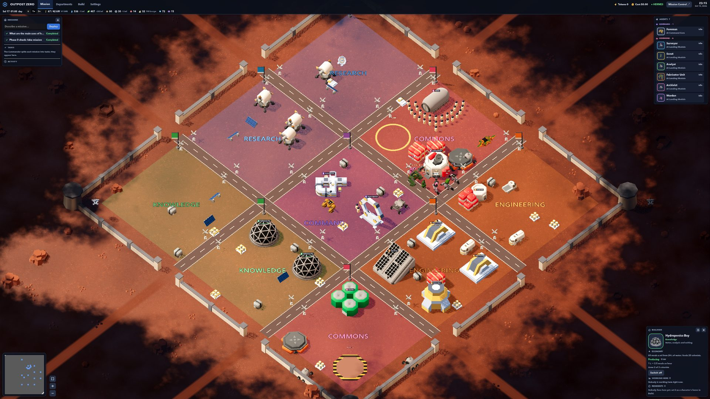
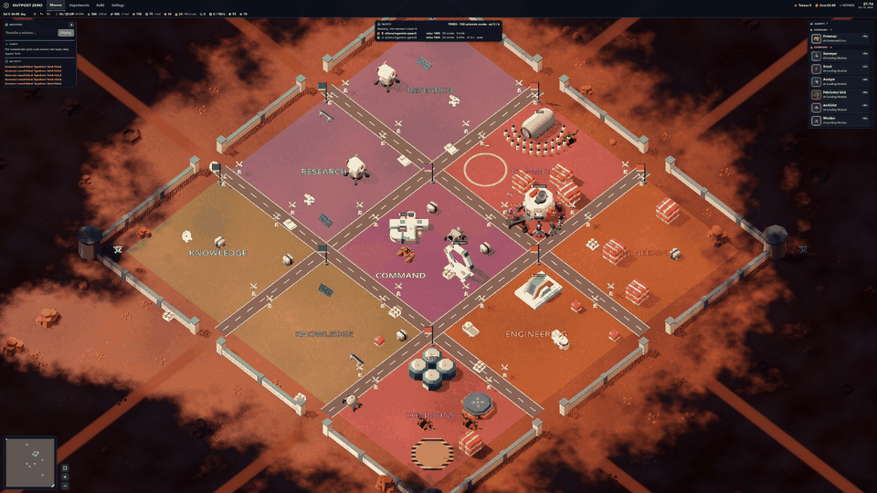
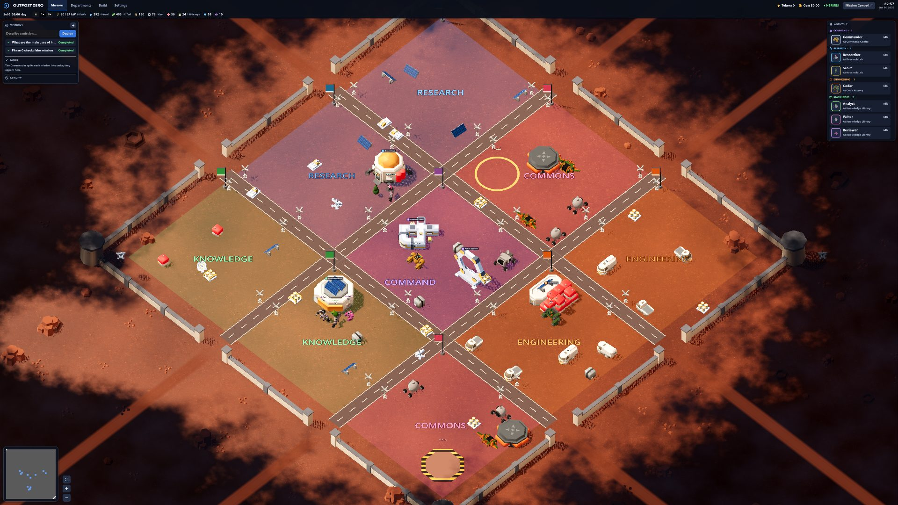
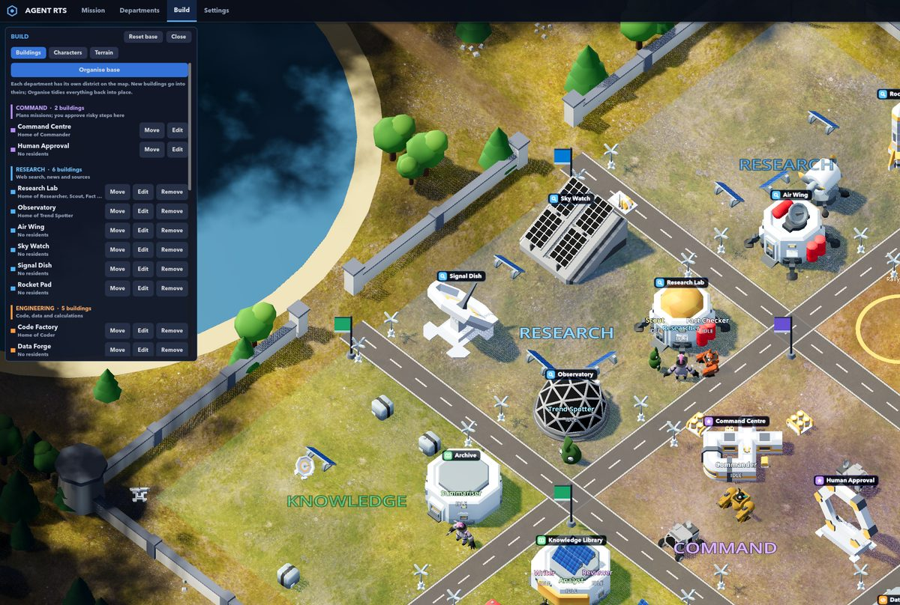
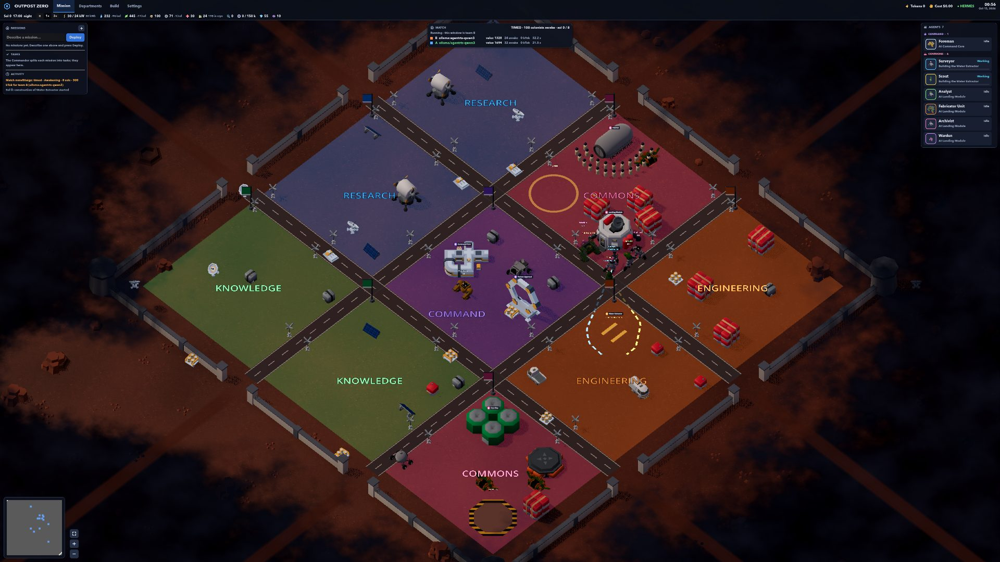

# Outpost Zero

**Humanity ends here. Or begins again.**

A science-fiction colony simulator in which every worker is a real AI agent. Odyssey-7 has
crashed on a planet that was not uninhabited; 24 colonists are awake, 198 sleep in cryo, six
machines survived, and the colony AI, MOTHER, has deleted 17 years of its own memory. Keep
them alive, build, find out what happened. Or set a match up and let two models run the same
colony against each other.



Outpost Zero started on 2026-10-14 from the [Agent RTS](https://github.com/hungnv26/agent-rts)
foundation: a Godot 4 scene (fork of Open RTS) in which every character is a
[Hermes Synapse](https://github.com/pauloberezini/hermes-synapse) agent, mirrored into
[Mission Control](https://github.com/builderz-labs/mission-control). It runs beside Agent RTS
without conflict: Hermes on 8101, Mission Control on 3001 (no sign-in screen on this Mac; [docs/settings.md](docs/settings.md)), the adapter on 8771.

## Two ways to play

**Campaign.** Run the colony. Water and food first, then power and materials; wake colonists
when production can carry them; build a Research Lab and send the agents on real missions to
earn data; decide how much autonomy the machines get. The story emerges from the numbers:
a surplus brings the first artifact and Chapter II, the ruins ask for a choice, a Relay Dish
catches a 46-year-old warning. Chapters I and II are in this version; the rebellion, the truth
about Earth and the four endings are written in [docs/story.md](docs/story.md) and come next.

**Arena.** Teams of Hermes agents on different models play the same colony from the same seed.
The faster, smarter model wins: the clock never waits, and every team gets the same token
budget. [docs/arena.md](docs/arena.md).



| The colony strip | Build mode | Two teams |
|---|---|---|
|  |  |  |

## Two modes

**Outpost War** is the real-time strategy battle that comes with Outpost Zero: build an army and
destroy the other players. It is [Open RTS](https://github.com/lampe-games/godot-open-rts) by
Lampe Games, the Godot 4 game this project is built on. Battles are set up on the Arena Setup
page, the same one that runs Outpost Zero's races: run `scripts/start.sh --war` and open
http://127.0.0.1:8790/#war, choose the map and the number of players, and for each one an AI model
(Claude, GPT, OpenRouter or the local model), the scripted computer player or you, then *Start
battle*; the result comes back to the page ([docs/rts-arena.md](docs/rts-arena.md)). Neither game has a settings screen
([docs/settings.md](docs/settings.md)).
[docs/outpost-war.md](docs/outpost-war.md).

## How it works

| Part | Project | Runs on | Job |
|---|---|---|---|
| Game | [godot-open-rts](https://github.com/lampe-games/godot-open-rts) fork in `game/` | Godot 4.4+ | Draws the base, the machines, the colonist crowd, day and night, the HUD. No AI. |
| Agents | [hermes-synapse](https://github.com/pauloberezini/hermes-synapse) | Docker, 127.0.0.1:8101 | The Foreman plans each mission and delegates to the six machines; the Governor plays the Arena through the colony tools. |
| Operations | [mission-control](https://github.com/builderz-labs/mission-control) | 127.0.0.1:3001 | Missions, approvals, tokens and cost; the Arena lobby and results. |
| Adapter | `adapter/` (this repo, TypeScript) | 127.0.0.1:8771 (Arena API 8772) | The economy, the map, the Oversight Post (human approval) checkpoint, the Arena referee. The only writer of the world. |

Everything on screen is a number the adapter computed this game hour or something Hermes did:
no decorative meters. The economy's numbers live in `design/economy.json` and are balanced by
`node tools/economy_sim.mjs 80`, which plays the opening on the adapter's own code and fails if
anyone dies. The design documents: [master plan](docs/master-plan.md),
[economy](docs/economy.md), [arena](docs/arena.md), [story](docs/story.md).

## Quick start (macOS, Apple Silicon)

Prerequisites: Docker (Colima with 6 GB is enough), Node 23.6+, pnpm, Godot 4.4+
(`brew install --cask godot`) and Ollama (`ollama serve`).

```bash
scripts/setup.sh      # once: pinned foundations, local model, Hermes images, deps (~10 min)
scripts/start.sh      # Hermes + Mission Control + adapter, then opens the game
```

- **Build** tab: the catalog. Start with a Water Extractor, a Solar Array and a Scrap Yard;
  two idle machines build each one.
- **Cryo Bay** (click it): wake 8 colonists once food and water can carry them.
- **Missions** panel: type a question and Deploy. The Surveyor's web research is an expedition
  that brings salvage; a mission completed through a powered Research Lab earns data; data buys
  research in the Build tab.
- **Departments** tab: autonomy per department. At Delegated MOTHER approves reports itself;
  at Autonomous it starts missions on its own.
- Speed: pause, 1x or 3x in the colony strip. A game hour is a real minute at 1x. The colony is
  saved in `.data/colony.json`; **Reset base** starts again at the crash site.
- Demo without any LLM: `scripts/start.sh --fake`. Stop everything: `scripts/stop.sh`.

## Arena

```bash
scripts/arena.sh up B=ollama:agentrts-qwen3                 # a second team: its own Hermes and adapter
scripts/arena.sh start --teams A,B --mode race --objective awakening --sols 60
OUTPOST_ZERO_WS=ws://127.0.0.1:8781/world godot --path game # watch team B's window
```

The teams sit on opposite sides of one map (`design/maps.json`: `duel`, `trio`, `quad`); each
window shows its own base and the other teams' bases across the wild, read from their adapters.

Frontier models: put the provider keys in `infra/providers.env` (gitignored) and bring a team
up with `B=anthropic:claude-opus-4-1` or `B=openai:gpt-5`. Each team is a Docker Compose project
with its own model file. The director keeps an Elo per model in `.data/elo.json` and posts the
result to Mission Control. A task there moved to *in progress* with
`metadata.arena = {mode, objective, sols, tokenBudget, seed, model}` also starts a match for the
main stack, and the result returns as a comment.

## The base

The story runs through four chapters to four endings (Exodus, New Eden, Singularity,
Extinction): from Chapter III the machines split into factions and MOTHER can be shut down;
Chapter IV (Alien Tech and a Relay Dish) opens the Launch Gantry and the Network Link.

Five sectors on a 3×3 district grid: Command (MOTHER's core, the Oversight Post), Science
(the lab, the dish, the dig), Industry (power, water, salvage, parts), Life Support
(hydroponics, medicine), Quarters (the lander, cryo, habitats, storage). A site goes into its
department's district or where you click. Buildings draw power in a fixed priority: life
support, cryo pods, water, food, medical, command, research, industry, excavation, machines;
at night the reactor alone cannot carry industry, which is what the Battery Bank is for.

The six machines are the real agents: Surveyor, Scout, Analyst, Fabricator Unit, Archivist and
Warden, with the Foreman as MOTHER's proxy. They live at the lander until a Research Lab or a
Fabricator stands, build the sites, go on expeditions, run the missions, and at high influence
start picking tasks of their own.

## Repository layout

```
adapter/            the economy (economy.ts), the map (layout.ts), the referee (arena.ts),
                    Hermes and fake sources, the Mission Control sink; `npm test`
design/economy.json every number of the economy, the story cards and the events
docs/               master plan, economy, arena, story, architecture, screenshots
game/               Godot project; Outpost Zero code in game/source/agent/
infra/              Hermes compose override, the plugin (agents + colony tools), SearXNG, Ollama
scripts/            setup, start, stop, gen-env, run-mission, arena
tools/              economy simulator, plan driver, match director, terrain tools
```

## Development

```bash
cd adapter && npm test && npm run typecheck     # 36 tests, the balance check among them
node tools/economy_sim.mjs 80                    # the opening, sol by sol
COLONY_SECONDS_PER_HOUR=0.3 node adapter/src/main.ts   # a fast clock for play-testing
node tools/play_default.mjs 12                   # the default build order over the HTTP API
godot --path game -- --capture-dir=/tmp/shots --capture-at=8 --quit-after-capture   # screenshots
```

The world contract (events and commands) is in `adapter/src/contract.ts` and
[docs/architecture.md](docs/architecture.md); the economy's additions are in
[docs/economy.md §13](docs/economy.md).

## Known limitations

- The local 4B model plays the Arena cautiously and sometimes misses the 45-second Hermes limit;
  a hosted model is the quality fix for both missions and matches.
- Hermes does not always report the Governor's chat in its token log; the referee then estimates
  the round's tokens from its length and says so in the code.
- Chapters III and IV, the endings, machine factions and Contest mode are after version 1.

## Licences

Outpost Zero's code is MIT (Hung Ngo). The game is a fork of Open RTS (MIT, Pawel Lampe) with
Kenney's Space Kit, KayKit Space Base Bits and the Quaternius Ultimate Space Kit (all CC0),
terrain textures from Poly Haven scans (CC0), and the logos listed in `game/LOGO_LICENSES.md`.
Hermes Synapse and Mission Control are MIT and stay unmodified in `vendor/` (the no-sign-in front is our own `tools/mc_open.mjs`).
